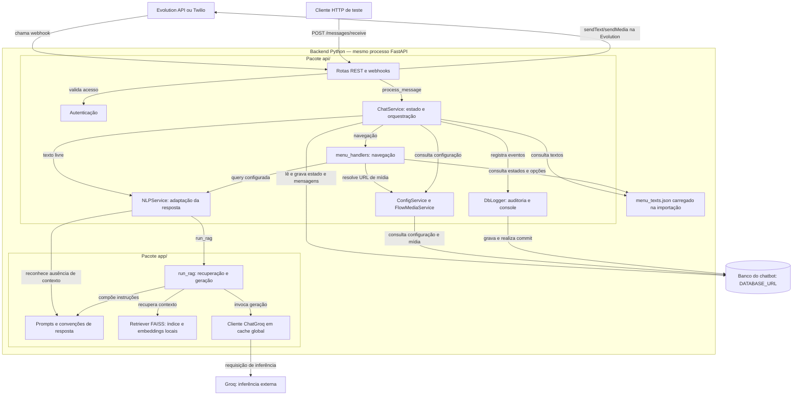
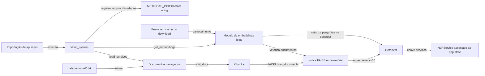
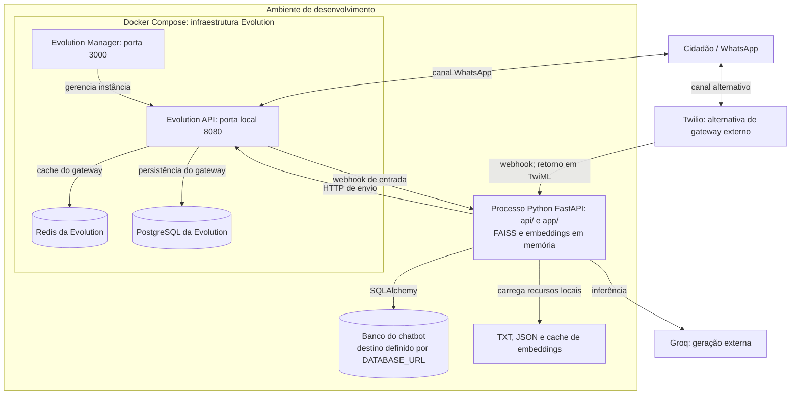

# 02 — Arquitetura

Complemento: [interfaces e contratos atuais](13-interfaces-e-contratos.md), com entradas, saídas, efeitos colaterais, falhas e evidências de execução. As limitações abertas estão em [problemas conhecidos](10-problemas-conhecidos.md).

## Escopo e convenções

Revisão em 08/11/2026 sobre o commit `65e28a05f6d0274a14d187e2bd6e5790b4504979`. O conteúdo funcional de `api/`, `app/`, `data/` e `tests/` permanece igual ao corte `666b601` usado no C03, conferido por `git diff`. Esta revisão atualiza a documentação, sem alterar a aplicação ou os registros brutos dos experimentos. A versão anterior dos diagramas foi inspecionada em 20/10/2026, sobre `731e856`.

O objetivo é documentar a arquitetura implementada: componentes, responsabilidades, camadas, dependências e decisões identificáveis no código. A inspeção dos módulos foi confrontada com as descrições técnicas existentes e com os resultados de [C01](avaliacao/C01-analise-resultados.md), [C02](avaliacao/C02-relatorio-execucao.md), [C03-A](avaliacao/C03-relatorio-execucao.md) e [C03-B](avaliacao/C03-B-relatorio-execucao.md). Resultados de execução aparecem identificados com o respectivo recorte; não se apresentam propostas de manutenção como capacidades já implementadas.

Na visão de componentes, setas indicam uso ou acesso; na sequência, chamadas e retornos; na implantação, comunicação entre processos e serviços. Os grupos `api/` e `app/` são pacotes do mesmo backend. A denominação **monólito com organização em camadas lógicas** é uma interpretação dessa estrutura, não uma separação em serviços implantáveis nem uma arquitetura de camadas estritamente isoladas.

## Visão de componentes



O limite externo reúne dois pacotes no mesmo processo, sem separação em microsserviços. As respostas das chamadas ficam implícitas nesta visão; a devolutiva ao cidadão aparece na sequência. O índice vetorial é distinto do banco relacional. O cache guarda o cliente de inferência, não pesos do modelo nem respostas anteriores. A resolução de mídia obtém URLs, sem servir os arquivos de imagem.

### Componentes e fontes de implementação

| Componente | Responsabilidade e fronteira | Fontes principais |
|---|---|---|
| Adaptadores de entrada/saída | Extrair mensagens, autenticar a entrada e adaptar a resposta para JSON, TwiML ou envio Evolution | [REST](../api/routes/routes.py), [Evolution](../api/routes/webhook.py), [Twilio](../api/routes/twilio_webhook.py), [segurança](../api/security.py) |
| Conversação | Identificar usuário, conduzir onboarding/comandos, decidir entre navegação e consulta e coordenar persistência | [ChatService](../api/services/chat_service.py) |
| Interpretador/configuração de menu | Ler estados/opções do JSON, atualizar estado ou encaminhar `query` ao NLP | [menu_handlers](../api/services/menu_handlers.py), [menu_texts.json](../api/services/menu_texts.json) |
| Ponte de linguagem natural | Receber pergunta, chamar o RAG, reconhecer ausência de contexto e personalizar a resposta localmente | [NLPService](../api/services/nlp_service.py) |
| Montagem e pipeline RAG | Carregar/dividir documentos, criar índice/retriever e compor recuperação, prompt e geração | [setup_system](../app/main.py), [run_rag](../app/core/rag_pipeline.py), [adaptadores RAG](../app/adapters/) |
| Configuração e mídia | Consultar parâmetros ativos e resolver URL de imagem por prioridade de fontes | [ConfigService](../api/services/config_service.py), [FlowMediaService](../api/services/flow_media_service.py) |
| Persistência e auditoria | Manter usuário, estado, mensagens, configuração, mídia e eventos no banco relacional; emitir logs | [modelos](../api/models/models.py), [sessão](../api/db/database.py), [DbLogger](../api/utils/logger.py), [migrações](../api/alembic/versions/) |

**Caminho separado do Gradio:** `frontend/gradio_app.py` chama `setup_system()` e `generate_response()` diretamente em seu processo, chegando a `run_rag`. Não usa a rota REST, o ChatService ou a persistência de conversas do backend. Testes também podem chamar serviços diretamente, conforme seu escopo.

## Visão de inicialização



Os TXT são lidos durante a montagem. Durante a consulta, o retriever acessa o índice e os documentos em memória; não relê os TXT a cada pergunta. Não há persistência do índice em disco. Cada processo que executa a montagem cria seus próprios recursos. O cliente de geração é criado sob demanda, separadamente da indexação.

A montagem ocorre no nível de módulo, antes de concluir a importação da aplicação. Não existe caminho explícito de inicialização somente com menus quando a montagem do RAG falha. O download dos embeddings depende da presença dos pesos no cache local.

## Visão de sequência — mensagem e devolutiva

Caminho normal de uma mensagem textual aceita pelo webhook. A consulta RAG representa uma pergunta documental; onboarding e comandos são decididos pelo ChatService. Setas tracejadas representam retornos.

```mermaid
sequenceDiagram
    actor U as Cidadão no WhatsApp
    participant G as Gateway Evolution ou Twilio
    participant H as Adaptador HTTP
    participant C as ChatService
    participant M as Interpretador de menus
    participant N as NLPService / run_rag
    participant R as Retriever FAISS local
    participant L as Groq
    participant D as Banco do chatbot
    U->>G: Mensagem via WhatsApp
    G->>H: POST no webhook
    H->>H: Autenticar e extrair identificador e texto
    H->>C: process_message(id_wpp, text)
    C->>D: Buscar/criar usuário e conversa; registrar recepção
    Note over C,D: Auditoria usa a mesma sessão e também realiza commits
    C->>D: Adicionar mensagem do usuário
    alt Comando ou resposta local
        C->>C: Determinar resposta e estado
    else Escolha de menu
        C->>M: Interpretar estado e opção
        opt Opção com query documental
            M->>N: process(query, user_name)
            N->>R: Recuperar contexto
            R-->>N: Documentos recuperados
            N->>L: Prompt com pergunta e contexto
            L-->>N: Resposta gerada
            N->>N: Reconhecer ausência e personalizar localmente
            N-->>M: Texto ou None
        end
        M-->>C: ChatResponse
    else Texto livre encaminhado ao RAG
        C->>N: process(texto, user_name)
        N->>R: Recuperar contexto
        R-->>N: Documentos recuperados
        N->>L: Prompt com pergunta e contexto
        L-->>N: Resposta gerada
        N->>N: Reconhecer ausência e personalizar localmente
        N-->>C: Texto ou None
        C->>C: Compor resposta conforme estado e resultado
    end
    C->>D: Adicionar resposta e confirmar persistência
    C->>D: Registrar MESSAGE_SENT e durações
    C-->>H: ChatResponse com texto e URL opcional
    alt Evolution API
        H->>G: POST sendText ou sendMedia
        G-->>H: Resultado HTTP do envio
        H-->>G: Resposta HTTP do webhook
    else Twilio
        H-->>G: Resposta HTTP com TwiML
    end
    G-->>U: Encaminhamento da resposta pelo WhatsApp
```

A última seta representa o encaminhamento esperado pelo canal; não há confirmação de entrega ao aparelho nessa sequência. `MESSAGE_SENT` é registrado antes do envio pelo adaptador. No caminho REST, o adaptador retorna JSON ao cliente HTTP, sem gateway.

Na Evolution, uma falha no envio da imagem provoca tentativa de envio somente do texto; falha final de envio produz HTTP 502. A Twilio recebe instruções TwiML no retorno do webhook, sem chamada de envio equivalente a `send_text`.

O desenho não representa uma transação atômica nem garante recuperação após falhas. Texto livre tem captura local de exceção do NLP, enquanto uma query de menu pode alcançar o tratamento geral do ChatService. Auditoria e conversa compartilham a sessão. Essas diferenças estão detalhadas nas interfaces I03 e I06 do [levantamento de contratos](13-interfaces-e-contratos.md).

## Visão de implantação — desenvolvimento



Topologia descrita pelos arquivos de desenvolvimento, sem afirmar que os serviços estejam em execução. O serviço chamado `api` no `docker-compose.yaml` é a **Evolution API**. O backend FastAPI é iniciado separadamente e não possui contêiner declarado nesse Compose.

O banco do chatbot é definido por `DATABASE_URL`; sua posição no ambiente é ilustrativa, pois a configuração pode apontar para outro servidor. Ele é distinguido logicamente do banco da Evolution, sem presumir servidor dedicado ou compartilhamento. Redis pertence ao gateway, não ao RAG. Evolution e Twilio são alternativas suportadas, sem failover automático implementado entre elas.

O endereço acessível do webhook e a configuração de rede dependem do gateway escolhido; proxy, túnel e hospedagem pública não são definidos aqui. O Gradio pode rodar em outro processo, com sua própria montagem do RAG, e foi omitido da topologia WhatsApp.

## Dois pacotes no mesmo processo

O projeto tem dois pacotes Python que rodam juntos:

| Pacote | Responsabilidade | Depende de |
|---|---|---|
| `app/` | Núcleo RAG, separado das rotas HTTP, persistência de conversas e WhatsApp. Inclui acesso ao provedor e carga de modelos/documentos. | LangChain, FAISS, HuggingFace, Groq |
| `api/` | Backend FastAPI. Estado da conversa, menus, persistência, webhooks. | FastAPI, SQLAlchemy, Alembic, `app/` |

`api/main.py` amarra os dois:

```python
pln_resources = setup_system()                       # app/ constrói o índice FAISS
app.state.nlp_service = NLPService(retriever=pln_resources["servicos"])
```

O índice é construído **uma vez, na subida do processo**, e fica em memória
(alcançável pelo retriever de `app.state.nlp_service`). Esse é o comportamento da entrada `api.main`; uma chamada explícita adicional a `setup_system()` monta novos recursos. Não há persistência do índice em disco.

## Camadas lógicas e dependências efetivas

As camadas abaixo descrevem responsabilidades. As pastas não impõem uma regra automática de dependência ou encapsulamento.

| Camada/responsabilidade | Implementação | Dependências efetivas |
|---|---|---|
| Entrada e adaptação do canal | Rotas, segurança, dependências de autenticação e schemas | Chamam ChatService e obtêm sessão/NLP; Evolution também realiza envio HTTP externo |
| Aplicação e conversação | ChatService, interpretador de menus e serviços de configuração/mídia | Acessam modelos e sessão SQLAlchemy diretamente; o interpretador pode chamar o NLP |
| Recuperação e geração | NLPService, `app/core/` e `app/adapters/` | NLPService depende do pipeline; o pipeline usa retriever, prompts e cliente externo. `core/` também importa bibliotecas e adaptadores concretos |
| Persistência e observabilidade | `api/models`, `api/db`, DbLogger e Alembic | SQLAlchemy e banco configurado; DbLogger usa a sessão da conversa e faz commits/rollbacks |
| Composição/inicialização | `api.main` e `app.main` | Conectam os recursos concretos, carregam modelos/documentos e publicam o NLP no estado da aplicação |

O fluxo predominante é **rotas → ChatService/menus → NLPService → RAG**, com acessos laterais ao banco e à auditoria. ChatService reúne lógica de conversação e operações de persistência; não existe uma camada de repositórios separando essas responsabilidades. A organização `core/adapters` do RAG não demonstra, por si só, arquitetura hexagonal ou inversão completa das dependências: o núcleo importa componentes concretos.

O retriever é fornecido ao NLPService, enquanto o cliente gerador é obtido por função interna e variável global no pipeline. O ChatService recebe o NLP por construtor e evita sua importação em tempo de execução usando `TYPE_CHECKING`. São pontos de substituição diferentes; a avaliação sistemática de testabilidade continua no escopo de C04. O Gradio acessa o núcleo por outro caminho, sem atravessar as camadas de conversação e persistência do backend.

## Camadas do `api/`

```
security.py   Autenticação das rotas de entrada. Sem import de app/ nem services.
routes/       Adaptadores HTTP: validação/extração do canal e entrega da resposta.
services/     Regra de negócio:
                chat_service.py     máquina de estados + orquestração
                menu_handlers.py    navegação do menu dinâmico (JSON)
                nlp_service.py      ponte para o RAG do app/
                config_service.py   leitura/escrita de system_configs
                flow_media_service.py  resolução de URL de imagem
schemas/      Pydantic: MessageSchema (entrada), MessageOut / ChatResponse (saída)
models/       SQLAlchemy: User, Chat, Message, SystemConfig, FlowMedia, AuditLog
db/           Engine, SessionLocal, get_db
dependencies/ exigir_token — dependência FastAPI de autenticação
utils/        DbLogger (log em console + tabela audit_logs)
alembic/      Migrações
```

## Camadas do `app/`

```
core/ingestion.py    DirectoryLoader sobre data/servicos/*.txt
core/intencao.py     e_saudacao() — biblioteca padrão, sem LLM
core/rag_pipeline.py get_llm (cache global), run_rag
core/conversation.py generate_response — usada apenas pelo Gradio
adapters/splitter.py RecursiveCharacterTextSplitter (1000/200)
adapters/embeddings.py  HuggingFaceEmbeddings, modelo multilíngue
adapters/vector_store.py FAISS.from_documents + as_retriever(k=10)
adapters/prompts.py  greeting_prompt, rag_prompt
adapters/respostas.py RESPOSTA_SEM_CONTEXTO, sem_contexto() — sem imports
main.py              setup_system() → {"servicos": retriever}
```

Os módulos `intencao.py` e `respostas.py` não importam dependências externas. O primeiro reconhece saudações localmente; o segundo mantém a convenção de ausência de contexto usada pelo prompt e pelo NLP. Essa separação e a importação do NLP apenas para tipagem no ChatService permitem exercitar parte da lógica sem carregar o stack RAG. O [CI](../.github/workflows/ci.yml) não instala as dependências completas de `app/` e mede cobertura de `api/`; seus testes não demonstram cobertura do núcleo RAG real.

## Ciclo de vida de uma mensagem

1. Gateway entrega a mensagem no webhook correspondente.
2. A rota autentica a requisição via `api/security.py` — assinatura Twilio ou segredo
   compartilhado. Falhou, responde 403 e nada mais acontece.
3. A rota extrai `id_wpp` e `text` e instancia `ChatService(db, nlp_service)`.
4. `ChatService.process_message`:
   1. normaliza o texto (`_clean_text`);
   2. busca/cria `User` e `Chat`;
   3. grava log em `audit_logs` (`MESSAGE_RECEIVED`);
   4. persiste a mensagem do usuário;
   5. decide a resposta pela máquina de estados (ver [doc 05](05-fluxo-conversa.md));
   6. persiste a resposta do bot e faz `commit`;
   7. registra `MESSAGE_SENT`, estado e durações, antes da entrega pelo canal.
5. A rota converte `ChatResponse` no formato do gateway:
   - Evolution: chama `send_image` ou `send_text` via HTTP;
   - Twilio: devolve TwiML XML com `<Body>` e opcional `<Media>`;
   - REST: devolve JSON `MessageOut`.

O tratamento geral de erros em `process_message` tenta fazer `rollback` e devolver
`"Desculpe, ocorreu um erro interno."`. Isso não garante recuperação diante de toda falha
de infraestrutura. O caminho de texto livre contém ainda uma captura própria de falhas do
NLP, diferente da consulta pelo menu. A auditoria usa a mesma sessão e também realiza
commits; portanto, não se deve presumir uma única transação atômica para toda a mensagem.
Ver as interfaces I03 e I06 no [levantamento de contratos](13-interfaces-e-contratos.md).

## Decisões de projeto identificadas no código

O quadro registra escolhas materializadas na implementação e seus efeitos. Não é um conjunto de ADRs históricos nem prova de que alternativas foram comparadas pelo autor original. As consequências são identificadas por inspeção ou pelos ensaios citados. Motivações só são atribuídas quando estão registradas nos comentários/documentos; por exemplo, o adaptador de embeddings justifica o modelo multilíngue pela base em português.

| ID | Escolha implementada | Rastreabilidade | Consequência, limite ou evidência |
|---|---|---|---|
| D01 | API e RAG no mesmo processo, conectados durante a importação | [api.main](../api/main.py), [app.main](../app/main.py) | As chamadas são diretas; falha na montagem do RAG impede concluir a importação da aplicação. Não há inicialização alternativa só com menus |
| D02 | Conversação híbrida, com estado/opções em JSON e consultas documentais | [ChatService](../api/services/chat_service.py), [interpretador](../api/services/menu_handlers.py), [JSON](../api/services/menu_texts.json) | Extensões compatíveis podem ficar em JSON/TXT, como C01 demonstrou. Novos tipos de operação podem exigir Python; o JSON é carregado na importação |
| D03 | Documentos locais e índice FAISS em memória, reconstruído na montagem | [ingestão](../app/core/ingestion.py), [setup](../app/main.py), [vector store](../app/adapters/vector_store.py) | Evita reutilizar um índice persistido desatualizado, mas exige reconstrução e recursos por processo. C02 mediu custo de montagem; benefício de persistir índice não foi comparado |
| D04 | Embeddings locais e inferência externa | [embeddings](../app/adapters/embeddings.py), [pipeline](../app/core/rag_pipeline.py) | Modelo de embeddings padrão multilíngue e configurável por `EMBEDDINGS_MODEL`; o prompt documental inclui pergunta e contexto para inferência externa. C06 ainda avaliará o payload efetivo |
| D05 | Cliente ChatGroq global reutilizado, modelo fixo e parâmetros definidos no código | [get_llm](../app/core/rag_pipeline.py) | O cache reaproveita o cliente, não respostas. O padrão segue `llama-3.3-70b-versatile`; sua chamada falhou nos ensaios. O alternativo usado em C02/C03-B não foi incorporado à aplicação |
| D06 | Geração por pergunta/contexto, sem histórico de turnos na cadeia | [run_rag](../app/core/rag_pipeline.py), [generate_response](../app/core/conversation.py), [NLPService](../api/services/nlp_service.py) | Histórico persistido e estado do menu não equivalem a memória do LLM. O nome é usado na personalização local; o parâmetro `historico` do caminho Gradio não é utilizado |
| D07 | Sessão de banco compartilhada entre conversa, serviços auxiliares e auditoria | [get_db](../api/db/database.py), [ChatService](../api/services/chat_service.py), [DbLogger](../api/utils/logger.py), [FlowMediaService](../api/services/flow_media_service.py) | Há commits/rollbacks fora do fluxo principal; não existe garantia de transação única. C03-A observou erro de menu devolvido sem o par de mensagens salvo |
| D08 | Processamento de NLP, banco e envio Evolution síncrono em rotas `async` | [REST](../api/routes/routes.py), [Evolution](../api/routes/webhook.py), [ChatService](../api/services/chat_service.py), [pipeline](../app/core/rag_pipeline.py) | C03-B reproduziu bloqueio de outras conversas em um worker. Não há broker/consumidor de mensagens implementado; RabbitMQ é hipótese posterior |
| D09 | Autenticação no adaptador e normalização da identidade no serviço de conversa | [segurança](../api/security.py), [dependência REST](../api/dependencies/dependencies.py), [ChatService](../api/services/chat_service.py) | Segredo compartilhado em REST/Evolution e assinatura em Twilio; ausência de segredo nega acesso. Normalização reduz o identificador ao número. Isso não representa auditoria completa de segurança |
| D10 | Resolução de mídia por prioridade de fontes | [menu_handlers](../api/services/menu_handlers.py), [ConfigService](../api/services/config_service.py), [FlowMediaService](../api/services/flow_media_service.py) | `flow_media` → `system_configs` → ambiente → JSON. São URLs; o backend não hospeda as imagens. A consulta à mídia compartilha a sessão da conversa |
| D11 | Ausência de contexto reconhecida por convenção textual | [prompt](../app/adapters/prompts.py), [sem_contexto](../app/adapters/respostas.py), [NLPService](../api/services/nlp_service.py) | A instrução ao modelo e o reconhecimento da frase não garantem fidelidade. Texto livre também converte exceção em `None`; C03-A mostrou erro tratado como opção inválida |
| D12 | Splitter de 1.000 caracteres/200 de sobreposição e recuperação `k=10` | [splitter](../app/adapters/splitter.py), [retriever](../app/adapters/vector_store.py) | São parâmetros atuais, sem demonstração de configuração ótima. O volume de contexto integra a carga de tokens; C02/C03-B observaram limitação de quota com a base usada |

## Comportamento observado e limites da descrição

| Fonte de evidência | O que acrescenta à inspeção | Limite |
|---|---|---|
| [C01](avaliacao/C01-analise-resultados.md) | Inclusão de um serviço compatível por JSON/TXT, sem Python funcional | Um serviço sintético; geração completa condicionada a modelo alternativo |
| [C02](avaliacao/C02-relatorio-execucao.md) | Custo sequencial e montagem do índice; na série principal, vetorização/indexação superou carga dos embeddings nas três inicializações medidas | Cache/ambiente identificados; não comprova que carregar embeddings sempre domina nem quantifica ganho com índice persistido |
| [C03-A](avaliacao/C03-relatorio-execucao.md) | Dois tratamentos de falha: menu devolve erro interno com `MESSAGE_FAILED`; texto livre devolve opção inválida com `MESSAGE_SENT` | Injeção imediata e sequencial; não mede concorrência nem falha de boot |
| [C03-B](avaliacao/C03-B-relatorio-execucao.md) | Em um worker, inferência/retry/envio bloquearam outras requisições; menu de outro usuário levou 193,832 s na rajada real de dez | Modelo adaptado, SQLite e saída WhatsApp interceptada; processo não encerrou e a causa exata do incidente anterior não foi demonstrada |

Esses achados atualizam a descrição do sistema existente. Persistência do índice, memória de conversa, processamento em fila e política uniforme de erros são possibilidades de manutenção, não componentes implementados. A topologia de desenvolvimento não comprova a configuração de produção. Qualidade das respostas, confidencialidade e isolamento completo de testes ainda dependem dos cenários próprios C04–C06.

## Rastreabilidade do objetivo de documentação

| Parte do objetivo específico | Entrega desta documentação |
|---|---|
| Visão de componentes | Diagrama de componentes, tabela de responsabilidades/fontes e caminho independente do Gradio |
| Camadas | Camadas lógicas, dependências efetivas, composição e acoplamentos entre conversação, persistência e RAG |
| Decisões de projeto | D01–D12, com código correspondente e consequências delimitadas |
| Base no código e na documentação técnica | Corte identificado, inspeção dos módulos, contratos I01–I06, diagramas de execução/implantação e confronto com C01–C03 |

O objetivo de descrever a arquitetura atual tem essas entregas documentadas e rastreáveis. Isso não representa aprovação da arquitetura, validação por stakeholders ou avaliação completa dos atributos de qualidade.
