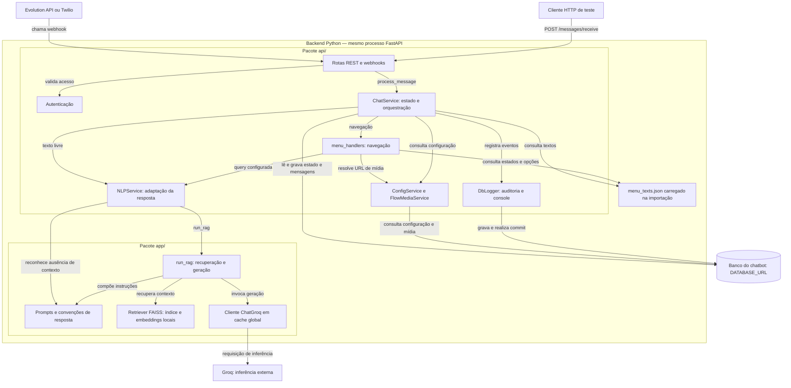
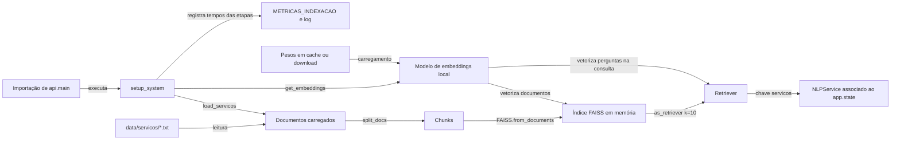
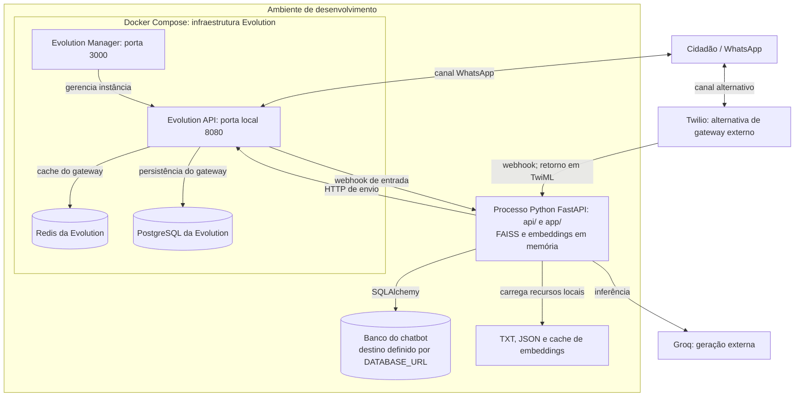

# 02 — Arquitetura

Complemento: [interfaces e contratos atuais](13-interfaces-e-contratos.md), com entradas, saídas, efeitos colaterais, falhas e lacunas identificadas por inspeção antes dos próximos cenários.

## Escopo e convenções

Diagramas revisados por inspeção do código em 20/10/2026, tomando como referência o commit `731e856`. Descrevem a implementação, sem antecipar resultados dos experimentos. Na visão de componentes, setas indicam uso ou acesso; na sequência, indicam chamadas e retornos; na implantação, comunicação entre processos e serviços.

## Visão de componentes



O limite externo reúne dois pacotes no mesmo processo, sem separação em microsserviços. As respostas das chamadas ficam implícitas nesta visão; a devolutiva ao cidadão aparece na sequência. O índice vetorial é distinto do banco relacional. O cache guarda o cliente de inferência, não pesos do modelo nem respostas anteriores. A resolução de mídia obtém URLs, sem servir os arquivos de imagem.

**Caminho separado do Gradio:** `frontend/gradio_app.py` chama `setup_system()` e `generate_response()` diretamente em seu processo, chegando a `run_rag`. Não usa a rota REST, o ChatService ou a persistência de conversas do backend. Testes também podem chamar serviços diretamente, conforme seu escopo.

## Visão de inicialização



Os TXT são lidos durante a montagem. Durante a consulta, o retriever acessa o índice e os documentos em memória; não relê os TXT a cada pergunta. Não há persistência do índice em disco. Cada processo que executa a montagem cria seus próprios recursos. O cliente de geração é criado sob demanda, separadamente da indexação.

A montagem ocorre no nível de módulo, antes de concluir a importação da aplicação. Não existe caminho explícito de inicialização somente com menus quando a montagem do RAG falha. O download dos embeddings depende da presença dos pesos no cache local.

## Visão de sequência — mensagem e devolutiva

Caminho normal de uma mensagem textual aceita pelo webhook. A consulta RAG representa uma pergunta documental; onboarding e comandos são decididos pelo ChatService. Setas tracejadas representam retornos.

```mermaid
sequenceDiagram
    actor U as Cidadão no WhatsApp
    participant G as Gateway Evolution ou Twilio
    participant H as Adaptador HTTP
    participant C as ChatService
    participant M as Interpretador de menus
    participant N as NLPService / run_rag
    participant R as Retriever FAISS local
    participant L as Groq
    participant D as Banco do chatbot
    U->>G: Mensagem via WhatsApp
    G->>H: POST no webhook
    H->>H: Autenticar e extrair identificador e texto
    H->>C: process_message(id_wpp, text)
    C->>D: Buscar/criar usuário e conversa; registrar recepção
    Note over C,D: Auditoria usa a mesma sessão e também realiza commits
    C->>D: Adicionar mensagem do usuário
    alt Comando ou resposta local
        C->>C: Determinar resposta e estado
    else Escolha de menu
        C->>M: Interpretar estado e opção
        opt Opção com query documental
            M->>N: process(query, user_name)
            N->>R: Recuperar contexto
            R-->>N: Documentos recuperados
            N->>L: Prompt com pergunta e contexto
            L-->>N: Resposta gerada
            N->>N: Reconhecer ausência e personalizar localmente
            N-->>M: Texto ou None
        end
        M-->>C: ChatResponse
    else Texto livre encaminhado ao RAG
        C->>N: process(texto, user_name)
        N->>R: Recuperar contexto
        R-->>N: Documentos recuperados
        N->>L: Prompt com pergunta e contexto
        L-->>N: Resposta gerada
        N->>N: Reconhecer ausência e personalizar localmente
        N-->>C: Texto ou None
        C->>C: Compor resposta conforme estado e resultado
    end
    C->>D: Adicionar resposta e confirmar persistência
    C->>D: Registrar MESSAGE_SENT e durações
    C-->>H: ChatResponse com texto e URL opcional
    alt Evolution API
        H->>G: POST sendText ou sendMedia
        G-->>H: Resultado HTTP do envio
        H-->>G: Resposta HTTP do webhook
    else Twilio
        H-->>G: Resposta HTTP com TwiML
    end
    G-->>U: Encaminhamento da resposta pelo WhatsApp
```

A última seta representa o encaminhamento esperado pelo canal; não há confirmação de entrega ao aparelho nessa sequência. `MESSAGE_SENT` é registrado antes do envio pelo adaptador. No caminho REST, o adaptador retorna JSON ao cliente HTTP, sem gateway.

Na Evolution, uma falha no envio da imagem provoca tentativa de envio somente do texto; falha final de envio produz HTTP 502. A Twilio recebe instruções TwiML no retorno do webhook, sem chamada de envio equivalente a `send_text`.

O desenho não representa uma transação atômica nem garante recuperação após falhas. Texto livre tem captura local de exceção do NLP, enquanto uma query de menu pode alcançar o tratamento geral do ChatService. Auditoria e conversa compartilham a sessão. Essas diferenças estão detalhadas nas interfaces I03 e I06 do [levantamento de contratos](13-interfaces-e-contratos.md).

## Visão de implantação — desenvolvimento



Topologia descrita pelos arquivos de desenvolvimento, sem afirmar que os serviços estejam em execução. O serviço chamado `api` no `docker-compose.yaml` é a **Evolution API**. O backend FastAPI é iniciado separadamente e não possui contêiner declarado nesse Compose.

O banco do chatbot é definido por `DATABASE_URL`; sua posição no ambiente é ilustrativa, pois a configuração pode apontar para outro servidor. Ele é distinguido logicamente do banco da Evolution, sem presumir servidor dedicado ou compartilhamento. Redis pertence ao gateway, não ao RAG. Evolution e Twilio são alternativas suportadas, sem failover automático implementado entre elas.

O endereço acessível do webhook e a configuração de rede dependem do gateway escolhido; proxy, túnel e hospedagem pública não são definidos aqui. O Gradio pode rodar em outro processo, com sua própria montagem do RAG, e foi omitido da topologia WhatsApp.

## Dois pacotes no mesmo processo

O projeto tem dois pacotes Python que rodam juntos:

| Pacote | Responsabilidade | Depende de |
|---|---|---|
| `app/` | Núcleo RAG, separado das rotas HTTP, persistência de conversas e WhatsApp. Inclui acesso ao provedor e carga de modelos/documentos. | LangChain, FAISS, HuggingFace, Groq |
| `api/` | Backend FastAPI. Estado da conversa, menus, persistência, webhooks. | FastAPI, SQLAlchemy, Alembic, `app/` |

`api/main.py` amarra os dois:

```python
pln_resources = setup_system()                       # app/ constrói o índice FAISS
app.state.nlp_service = NLPService(retriever=pln_resources["servicos"])
```

O índice é construído **uma vez, na subida do processo**, e fica em memória
(`app.state`). Não há persistência do índice em disco.

## Camadas do `api/`

```
security.py   Autenticação das rotas de entrada. Sem import de app/ nem services.
routes/       Adaptadores HTTP (Evolution, Twilio, REST). Sem regra de negócio.
services/     Regra de negócio:
                chat_service.py     máquina de estados + orquestração
                menu_handlers.py    navegação do menu dinâmico (JSON)
                nlp_service.py      ponte para o RAG do app/
                config_service.py   leitura/escrita de system_configs
                flow_media_service.py  resolução de URL de imagem
schemas/      Pydantic: MessageSchema (entrada), MessageOut / ChatResponse (saída)
models/       SQLAlchemy: User, Chat, Message, SystemConfig, FlowMedia, AuditLog
db/           Engine, SessionLocal, get_db
dependencies/ exigir_token — dependência FastAPI de autenticação
utils/        DbLogger (log em console + tabela audit_logs)
alembic/      Migrações
```

## Camadas do `app/`

```
core/ingestion.py    DirectoryLoader sobre data/servicos/*.txt
core/intencao.py     e_saudacao() — sem imports, sem LLM
core/rag_pipeline.py get_llm (cache global), run_rag
core/conversation.py generate_response — usada apenas pelo Gradio
adapters/splitter.py RecursiveCharacterTextSplitter (1000/200)
adapters/embeddings.py  HuggingFaceEmbeddings, modelo multilíngue
adapters/vector_store.py FAISS.from_documents + as_retriever(k=10)
adapters/prompts.py  greeting_prompt, rag_prompt
adapters/respostas.py RESPOSTA_SEM_CONTEXTO, sem_contexto() — sem imports
main.py              setup_system() → {"servicos": retriever}
```

Os dois módulos "sem imports" (`intencao.py`, `respostas.py`) são deliberados: são a
lógica que o `api/` precisa consultar, e mantê-los livres de LangChain é o que permite
testá-los — e testar quem os usa — sem baixar o modelo de embeddings no CI.

## Ciclo de vida de uma mensagem

1. Gateway entrega a mensagem no webhook correspondente.
2. A rota autentica a requisição via `api/security.py` — assinatura Twilio ou segredo
   compartilhado. Falhou, responde 403 e nada mais acontece.
3. A rota extrai `id_wpp` e `text` e instancia `ChatService(db, nlp_service)`.
4. `ChatService.process_message`:
   1. normaliza o texto (`_clean_text`);
   2. busca/cria `User` e `Chat`;
   3. grava log em `audit_logs` (`MESSAGE_RECEIVED`);
   4. persiste a mensagem do usuário;
   5. decide a resposta pela máquina de estados (ver [doc 05](05-fluxo-conversa.md));
   6. persiste a resposta do bot e faz `commit`.
5. A rota converte `ChatResponse` no formato do gateway:
   - Evolution: chama `send_image` ou `send_text` via HTTP;
   - Twilio: devolve TwiML XML com `<Body>` e opcional `<Media>`;
   - REST: devolve JSON `MessageOut`.

O tratamento geral de erros em `process_message` tenta fazer `rollback` e devolver
`"Desculpe, ocorreu um erro interno."`. Isso não garante recuperação diante de toda falha
de infraestrutura. O caminho de texto livre contém ainda uma captura própria de falhas do
NLP, diferente da consulta pelo menu. A auditoria usa a mesma sessão e também realiza
commits; portanto, não se deve presumir uma única transação atômica para toda a mensagem.
Ver as interfaces I03 e I06 no [levantamento de contratos](13-interfaces-e-contratos.md).

## Decisões de projeto relevantes

- **Índice em memória, reconstruído a cada boot.** O startup carrega o modelo de
  embeddings (com download se ausente) e vetoriza a base. A distribuição desse custo
  deve ser verificada no C02.
- **LLM em cache global** (`CACHED_LLM` em `rag_pipeline.py`): evita recriar o cliente
  Groq a cada requisição.
- **Menu como dado, não como código**: `menu_texts.json` descreve estados, textos,
  próximos estados e queries de RAG. Adicionar um menu não exige mudar Python.
- **Resolução de imagem em cascata**: `flow_media` (BD) → `system_configs` (BD) →
  variável de ambiente → fallback no JSON.
