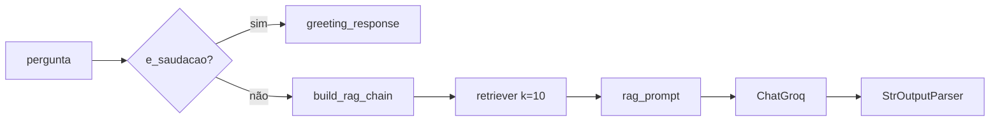

# 06 — Pipeline RAG

O núcleo RAG vive em `app/`, sem rotas FastAPI, persistência de conversas ou regras de WhatsApp. Ele usa bibliotecas concretas para modelos, recuperação e comunicação com o provedor externo. A ponte do backend é `api/services/nlp_service.py`; o Gradio chama o núcleo diretamente. Ver a [visão de camadas e dependências](02-arquitetura.md#camadas-lógicas-e-dependências-efetivas).

## Montagem (uma vez por processo)

`app/main.py`:

```python
def setup_system():
    docs_servicos   = load_servicos()                          # 1. carregar
    chunks_servicos = split_docs(docs_servicos)                # 2. fatiar
    embeddings      = get_embeddings()                          # 3. vetorizar
    vector_store    = create_vector_store(chunks_servicos, embeddings)  # 4. indexar
    retriever       = create_retriever(vector_store)            # 5. expor busca
    return {"servicos": retriever}
```

Chamado em `api/main.py` na subida e guardado em `app.state.nlp_service`.

### 1. Ingestão — `app/core/ingestion.py`

```python
DirectoryLoader(<raiz>/data/servicos, glob="*.txt",
                loader_cls=TextLoader, loader_kwargs={"encoding": "utf-8"})
```

Caminho resolvido a partir de `__file__`, então independe do diretório de execução.
Levanta `FileNotFoundError` se a pasta não existir. `glob="*.txt"` é raso — arquivos
em subpastas de `data/servicos/` são ignorados.

### 2. Chunking — `app/adapters/splitter.py`

`RecursiveCharacterTextSplitter`:

| Parâmetro | Valor |
|---|---|
| `separators` | `["\n\n", "\n", ". ", " ", ""]` |
| `chunk_size` | 1000 |
| `chunk_overlap` | 200 |
| `length_function` | `len` (caracteres) |

Como os arquivos têm ~1 KB a 3 KB, a maioria vira 1–3 chunks. Documentos curtos
tendem a sobreviver inteiros — bom para respostas de endereço/horário.

### 3. Embeddings — `app/adapters/embeddings.py`

Padrão: `sentence-transformers/paraphrase-multilingual-MiniLM-L12-v2`, sobrescrevível
pela variável `EMBEDDINGS_MODEL`.

O comentário do adaptador justifica a escolha multilíngue pela base em português. O adaptador não fixa o dispositivo de execução; C03-B registrou uso de CPU. Os pesos são carregados do cache ou obtidos pelo stack HuggingFace quando necessário. Nos ensaios offline foi preciso apontar `EMBEDDINGS_MODEL` para o snapshot local já existente, conforme os relatórios de C02/C03-B. Trocar o valor permite selecionar outro modelo, mas compatibilidade e qualidade exigem nova verificação.

> C01 verificou a recuperação de um documento sintético específico. Isso não equivale a avaliar a qualidade geral da recuperação. A amostra de fidelidade de respostas permanece no escopo de C05; cobertura de testes e facilidade de configuração também não comprovam qualidade.

### 4. Vector store — `app/adapters/vector_store.py`

```python
FAISS.from_documents(docs, embeddings)
vector_store.as_retriever(search_kwargs={"k": 10})
```

Índice **em memória**, sem `save_local`/`load_local`. Reconstruído a cada boot.
Na montagem real de C03-B, a base tinha 17 documentos e 39 chunks. `k=10` limita a recuperação de chunks, não a quantidade de arquivos inteiros. Esse valor não foi demonstrado como ótimo. A composição do contexto influencia o consumo de tokens; C02/C03-B registraram limitação de quota do provedor. Benefícios ou riscos de outros valores exigem comparação específica.

## Execução de uma pergunta

`app/core/rag_pipeline.py`:



### `get_llm()`

| Parâmetro | Valor |
|---|---|
| modelo | `llama-3.3-70b-versatile` (Groq) |
| `temperature` | 0.1 |
| `max_tokens` | 500 |
| cache | variável global `CACHED_LLM` |

Sem `GROQ_API_KEY` no ambiente, levanta `ValueError`.

O modelo da tabela é a configuração do código, não uma garantia de disponibilidade no provedor. C02 registrou `NotFoundError` com o padrão; a preparação C03-B de 08/11/2026 não o encontrou na conta e usou `openai/gpt-oss-120b` como configuração adaptada. Essa substituição não alterou o código funcional. O construtor padrão não fixa timeout/retries explicitamente; os valores efetivos das bibliotecas foram registrados em cada ensaio.

### `e_saudacao(texto)` — `app/core/intencao.py`

Detecção local, sem LLM: normaliza (minúsculas, sem acento, sem pontuação nas bordas) e
compara com um conjunto de saudações. Mensagem com mais de 3 palavras nunca é saudação,
então `"Oi, onde fica o CEMERF?"` vai para o RAG.

Deliberadamente local: classificar intenção com o LLM custaria uma chamada de Groq em
**toda** mensagem de texto livre, dobrando latência e custo para reconhecer "oi".

Uma saudação não reconhecida segue pelo caminho documental; o resultado depende da recuperação e da geração. O limite de palavras reduz o alcance da classificação local, sem comprovar ausência de falsos positivos ou negativos.

### `run_rag(retriever, question)`

1. Pergunta vazia → `"Digite uma pergunta válida."`
2. `e_saudacao` → resposta de saudação gerada pelo `greeting_prompt`.
3. Caso contrário → cadeia RAG:
   `{context: retriever, question: passthrough} | rag_prompt | llm | StrOutputParser()`

`build_rag_chain` é reconstruída a cada chamada; o cliente LLM vem do cache. O custo isolado dessa composição não foi medido.

## Prompts — `app/adapters/prompts.py`

| Prompt | Papel |
|---|---|
| `greeting_prompt` | Few-shot de um exemplo; gera a saudação institucional padrão |
| `rag_prompt` | Prompt principal do RAG |

Regras impostas pelo `rag_prompt`:

1. Usar **apenas** o contexto fornecido.
2. O contexto mistura vários serviços — identificar o serviço perguntado e usar só o
   trecho correspondente.
3. Não inventar links, formulários ou passos.
4. Sem resposta no contexto → responder **exatamente**
   `"Desculpe, não encontrei essa informação específica nos meus documentos."`

A frase do item 4 é reconhecida por `sem_contexto`, chamada no NLPService. O ChatService recebe texto ou `None`; não procura palavras como `desculpe` na resposta para tomar essa decisão.

## Ponte com o backend — `api/services/nlp_service.py`

```python
class NLPService:
    def __init__(self, retriever): ...
    def process(self, text, user_name=None) -> Optional[str]
```

**Devolve `None` para entrada vazia ou resposta reconhecida como ausência de contexto** — inclusive resultado vazio. Isso representa a convenção de ausência da aplicação, não uma verificação independente de que os documentos não contêm a resposta. Exceções de recuperação/inferência não são capturadas pelo NLPService. O ChatService as trata de formas diferentes em texto livre e query de menu, como [C03-A](avaliacao/C03-relatorio-execucao.md) confirmou.

A detecção mora em `app/adapters/respostas.py`:

```python
RESPOSTA_SEM_CONTEXTO = "Desculpe, não encontrei essa informação específica nos meus documentos."
NUCLEO_SEM_CONTEXTO   = "não encontrei essa informação"

def sem_contexto(resposta: str) -> bool
```

O módulo não importa nada — de propósito. Quem precisa saber "o RAG falhou?" não deveria
carregar LangChain para descobrir, e é isso que permite testar a máquina de estados no CI.
`rag_prompt` interpola `RESPOSTA_SEM_CONTEXTO`; o reconhecedor usa um núcleo textual dessa frase, sem exigir igualdade exata com toda a constante.

O casamento é pelo núcleo, não por igualdade exata: o modelo às vezes devolve a frase com
aspas, ponto final a mais ou quebra de linha.

Com resposta válida, personaliza a saudação:

| Condição na resposta | Substituição |
|---|---|
| contém a saudação institucional completa | `"Oi, {nome}! 😊\nComo posso te ajudar?"` |
| contém `"Olá!"` | troca `"Olá!"` por `"Oi, {nome}! 😊"` |

## Caminho alternativo: Gradio

`app/core/conversation.py` → `generate_response(mensagem, historico, retrievers_dict)`
é usada **apenas** por `frontend/gradio_app.py`. Ignora `historico` e chama `run_rag` diretamente. Não há histórico de turnos fornecido à geração nesse caminho nem no NLPService. Isso é distinto do estado de menu e das mensagens persistidas pelo backend.

## Testes

`app/test/` foi removido: eram três scripts de inspeção manual (só `print`, sem assert),
um deles quebrado havia tempo por importar um módulo inexistente. Os testes reais vivem
em `tests/` — ver [doc 11](11-ci.md).

Do pipeline RAG, o CI exercita a lógica que não exige LangChain, como `e_saudacao` e `sem_contexto`; não instala o stack completo de `app/`. Os instrumentos locais de C03 preservaram a cadeia/NLP reais com transporte de geração controlado, e C03-B também fez uma série com recuperação e provedor reais. Isso não equivale a cobertura de todo o núcleo ou avaliação de qualidade. C04 avaliará sistematicamente isolamento sem rede/credenciais, e C05 tratará fidelidade documental.
