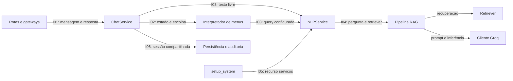

# 13 — Interfaces e contratos atuais

Levantamento por inspeção em 19/10/2026, sobre o código do commit `9990aed912706a0d8f75e7c6a9ddebca19e30a4d`. Complementa a [visão arquitetural](02-arquitetura.md) e antecede os próximos cenários da [árvore de utilidade](avaliacao/arvore-de-utilidade.md). Nenhum contrato novo foi implementado nesta etapa.

“Interface” designa aqui a fronteira de interação entre componentes. Assinaturas, modelos de dados, significado dos resultados, efeitos colaterais e tratamento de erros compõem o levantamento. Distingue-se o que o código declara, o comportamento identificado na leitura e o que ainda precisa de execução controlada. Ausência de classe abstrata ou `Protocol` não significa ausência de interface.

## Mapa das fronteiras

## I01 — Adaptadores de entrada e ChatService

**Fontes:** [schemas](../api/schemas/schemas.py), [ChatResponse](../api/schemas/responses.py), [rota REST](../api/routes/routes.py), [ChatService](../api/services/chat_service.py), [Evolution](../api/routes/webhook.py) e [Twilio](../api/routes/twilio_webhook.py).

| Aspecto | Contrato identificado |
|---|---|
| Operação | `await ChatService(db, nlp_service).process_message(id_wpp, text)` |
| Entrada declarada | Identificador e texto como `str`; sessão SQLAlchemy e serviço NLP fornecidos pelo chamador |
| Saída declarada | `ChatResponse(text: str, image_url: Optional[str])`; REST adapta para `MessageOut(response, image_url)` |
| Efeitos observados no código | Normalização, criação/leitura de usuário e conversa, atualização de estado, persistência de mensagens e auditoria |
| Falhas | Há captura geral em `process_message`, tentativa de rollback e resposta de erro interno; isso não constitui garantia de recuperação diante de qualquer falha de infraestrutura |
| Entrega | A resposta do serviço é consumida pelo adaptador; não confirma entrega ao aparelho. Evolution envia por HTTP; Twilio recebe TwiML como resposta |

**Lacunas:** não há prazo máximo declarado para a operação completa; a função é `async`, mas inclui chamadas síncronas ao banco e ao RAG. O efeito disso sobre concorrência não foi medido. Falhas de envio pertencem a outra fronteira, posterior à persistência da resposta. C02 mede o trecho da aplicação, não entrega por WhatsApp.

## I02 — Configuração e interpretador de menus

**Fontes:** [menu_handlers.py](../api/services/menu_handlers.py), [menu_texts.json](../api/services/menu_texts.json) e [testes estruturais](../tests/test_menu_texts.py).

| Aspecto | Contrato identificado |
|---|---|
| Entrada | Usuário com estado, escolha textual, serviço NLP e sessão de banco |
| Formato da configuração | Estados com texto e opções; `next_state` navega e `query` consulta o NLP; opções podem indicar imagem |
| Saída e efeito | `ChatResponse`; transição modifica `user.state`; consulta documental mantém o estado nesse ramo |
| Entrada inválida | Retorna aviso e texto do menu quando a opção não existe |
| Ciclo de vida | JSON lido na importação do módulo; não há mecanismo de atualização dinâmica demonstrado |

**Lacunas:** as regras do formato estão distribuídas entre interpretação e testes; não há modelo de validação do JSON declarado no carregamento. O ramo `query` chama o NLP diretamente e não captura sua exceção localmente. O C01 demonstrou uma extensão compatível com essas regras, sem avaliar novos tipos de operação.

## I03 — Consumidores e NLPService

**Fontes:** [NLPService](../api/services/nlp_service.py), [ChatService](../api/services/chat_service.py) e [interpretador](../api/services/menu_handlers.py).

| Aspecto | Contrato identificado |
|---|---|
| Construção | `NLPService(retriever)` recebe o recuperador; não recebe cliente gerador no construtor |
| Operação | `process(text: str, user_name: str = None) -> Optional[str]` |
| Texto retornado | Resultado do RAG, com possível personalização posterior |
| `None` | Entrada vazia ou resposta reconhecida como ausência de contexto; esse significado aparece na documentação do método |
| Exceção | O método não contém captura geral de erros de recuperação ou inferência; esses erros podem alcançar o consumidor |
| Nome | Usado na personalização após `run_rag`; passá-lo a `process` não prova que seja enviado ao provedor |

**Diferença entre consumidores, identificada por leitura:**

| Consumidor | Caminho quando o NLP lança exceção |
|---|---|
| Texto livre | `_perguntar_ao_rag` captura a exceção, registra log e devolve `None`; o fluxo subsequente pode tratar a situação como ausência de resposta |
| Opção de menu com `query` | `handle_dynamic_menu` não captura a exceção; ela pode alcançar o tratamento geral de `process_message` |

**Lacunas:** não há resultado estruturado que distinga ausência documental, falha de recuperação e falha de provedor. Os erros externos não estão normalizados em um contrato próprio. O serviço recebido pelo ChatService é substituível por um objeto com `process`, como no C01, mas a anotação aponta para a classe concreta. C03 verificará as consequências da diferença de tratamento; C04 verificará os pontos de substituição necessários ao teste do núcleo RAG.

## I04 — Pipeline, retriever e cliente de geração

**Fontes:** [rag_pipeline.py](../app/core/rag_pipeline.py), [prompts](../app/adapters/prompts.py), [vector_store.py](../app/adapters/vector_store.py) e [reconhecimento de ausência](../app/adapters/respostas.py).

| Aspecto | Contrato identificado |
|---|---|
| Operação de entrada | `run_rag(retriever: BaseRetriever, question: str) -> str` |
| Recuperação | A cadeia usa o retriever para compor o contexto; a fábrica atual usa FAISS e `k=10` |
| Geração | `get_llm()` instancia `ChatGroq` com modelo fixo, temperatura 0,1 e limite de 500 tokens; reutiliza cliente global em `CACHED_LLM` |
| Credencial | Lida de `GROQ_API_KEY`; ausência provoca `ValueError` ao criar o cliente |
| Ausência documental | Prompt solicita uma frase determinada; `sem_contexto` reconhece um núcleo textual na resposta. Trata-se de convenção textual dependente da geração |
| Entrada especial | Pergunta vazia retorna aviso local; saudação reconhecida usa outro prompt e também chama o modelo |

**Lacunas:** o construtor do cliente no código da aplicação não explicita timeout ou número de tentativas; valores efetivos dependem das bibliotecas e devem ser identificados na execução. Não há contrato próprio para erros do provedor. O gerador é obtido internamente e guardado em variável global, enquanto o retriever é parâmetro. Essa assimetria interessa ao C04. O prompt instrui ancoragem documental, mas a instrução não comprova fidelidade; C05 verificará uma amostra. C06 verificará o payload efetivo, em vez de inferi-lo apenas da assinatura.

## I05 — Inicialização e disponibilização dos recursos

**Fontes:** [setup_system](../app/main.py), [api/main.py](../api/main.py), [ingestão](../app/core/ingestion.py) e [embeddings](../app/adapters/embeddings.py).

| Aspecto | Contrato identificado |
|---|---|
| Operação | `setup_system()` carrega documentos, divide texto, obtém embeddings, cria índice e retriever |
| Saída | Dicionário com chave literal `servicos`; seu valor é utilizado para construir NLPService |
| Ciclo de vida | Executado no nível de módulo ao importar `api.main`; recurso fica associado ao serviço em `app.state` |
| Dependências | TXT locais, bibliotecas de RAG e pesos de embeddings disponíveis localmente ou por download |
| Métricas | Atualiza `METRICAS_INDEXACAO` e emite log com tempos por etapa |
| Falhas | Diretório ausente provoca `FileNotFoundError`; outras etapas podem lançar erros de biblioteca. Não há fallback de inicialização nesse fluxo |

**Lacunas:** formato do dicionário e chave de acesso não possuem esquema próprio; não existe caminho alternativo explícito que publique somente os menus quando a montagem do RAG falha. Portanto, preservar menus após falha de geração em processo iniciado (C03) é uma questão diferente de disponibilizar a aplicação após falha no boot. C02 mede a montagem, sem presumir garantia de inicialização.

## I06 — Persistência e auditoria

**Fontes:** [sessão de banco](../api/db/database.py), [ChatService](../api/services/chat_service.py), [DbLogger](../api/utils/logger.py) e [modelos](../api/models/models.py).

| Aspecto | Contrato identificado |
|---|---|
| Sessão | `get_db()` cria e fecha a sessão; ela é fornecida ao ChatService e aos serviços auxiliares |
| Persistência | ChatService grava usuário, conversa, mensagens e estado; realiza commit no fluxo principal e rollback no tratamento de falhas |
| Auditoria | `DbLogger.log_event` recebe a mesma sessão, registra mensagem no console e tenta gravar AuditLog |
| Efeito transacional | O logger também chama `commit()` e, em falha, `rollback()` na sessão recebida; não usa transação independente |
| Conteúdo | Logs de sucesso incluem identificador; caminhos de erro podem incluir texto da pergunta e mensagem de exceção. Metadados de duração não representam todo o conteúdo dos logs |

**Lacunas:** a propriedade das transações é compartilhada entre serviço de conversa e auditoria. Não se pode assumir atomicidade de toda a interação apenas porque existe um commit ao final de `process_message`. As consequências exigem avaliação própria antes de qualquer garantia de consistência. Para C06, verificar console, mensagem do evento e metadados, inclusive em falhas; o teste que evita texto no `meta` não garante ausência nos demais campos.

## Questões para a avaliação

| Questão identificada por inspeção | Cenário que poderá produzir evidência |
|---|---|
| Operações síncronas e espera externa no processamento | C02: duração observada no recorte sequencial, sem extrapolar para concorrência |
| Exceções tratadas de modo diferente nos consumidores do NLP | C03: resposta e navegação após falhas injetadas |
| Retriever fornecido externamente e gerador obtido por cliente global | C04: esforço e limites de isolamento nos testes |
| Ausência de contexto representada por convenção textual | C05: fidelidade e abstenção na amostra |
| Dados do usuário e conteúdo de erro podem alcançar logs ou payload | C06: rastreamento e captura controlada |
| Falha de montagem impede chegar à disponibilização dos recursos | Registrar como limitação do recorte de C03; não confundir com falha durante geração |
| Auditoria altera a transação compartilhada | Registrar dependência e risco a investigar; os cenários atuais não comprovam atomicidade |

Essas questões são achados de inspeção e hipóteses de impacto, não resultados antecipados dos cenários. Não há necessidade de criar classes abstratas para todas as fronteiras antes de avaliar. Uma futura recomendação pode envolver documentação, testes de contrato, política uniforme de falhas ou pontos explícitos de substituição, conforme as evidências.

## Condição para prosseguir

O levantamento inicial das interfaces está documentado. Antes da coleta de C02 a C06, conferir as fronteiras envolvidas no protocolo, fixar a versão de corte e distinguir comportamento atual de requisito desejado. Se alguma mudança funcional for escolhida, registrá-la como manutenção e atualizar a referência antes de medir; não misturar resultados de versões diferentes. C01 permanece como registro da versão já avaliada.
